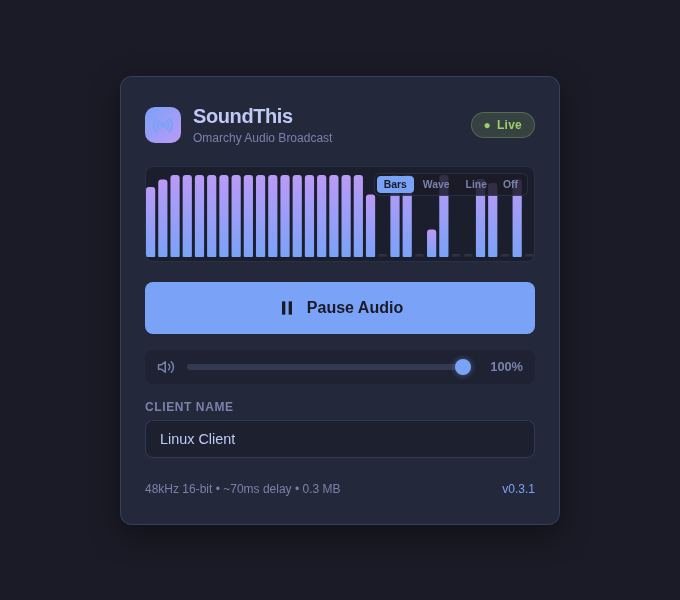
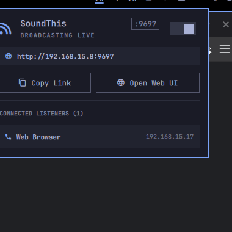
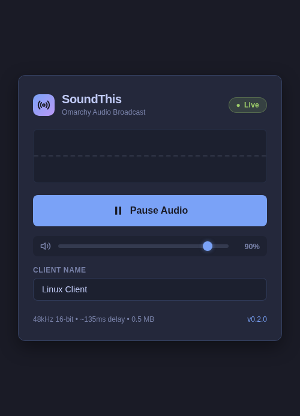

<p align="center">
  
</p>

<h1 align="center">SoundThis</h1>

<p align="center">
  <strong>Real-time desktop audio streaming for Omarchy Linux</strong><br>
  Ultra-low latency, single-binary, and built natively with Rust &amp; Vite.
</p>

<p align="center">
  <a href="https://github.com/rodvieirasilva/soundthis/releases"></a>
  <a href="https://github.com/rodvieirasilva/soundthis/actions/workflows/ci.yml"></a>
  <a href="LICENSE"></a>
  
</p>

SoundThis captures the audio playback from your Omarchy desktop (PipeWire/PulseAudio) in real-time and streams it to any web browser on your local network (smartphones, laptops, tablets, smart TVs) with ultra-low latency (~30–50ms) using WebSockets and the Web Audio API.

---

## Preview

<p align="center">
  
  &nbsp;
  
</p>

<p align="center">
  <em>Left: Embedded web player with real-time waveform visualizer, client naming, and live stream telemetry.<br>
  Right: Native Omarchy desktop bar widget and popout panel showing server link and active listeners.</em>
</p>

---

## Why SoundThis? (Comparison & Alternatives)

SoundThis was created as a modern, lightweight Linux alternative inspired by [SoundIt](https://soundit.app/). While SoundIt provides convenient audio streaming from Windows to mobile browsers, it is closed-source, proprietary, and limited to Windows hosts.

Other cross-platform tools like **AudioRelay** require installing dedicated native apps or APKs on every receiving phone/client, impose freemium restrictions, and consume significant memory (~80–120 MB RAM). Solutions like **Snapcast** or **RTP multicast** introduce high latency or require complex routing and custom daemon setups.

| Feature / Solution | **SoundThis** | [SoundIt](https://soundit.app/) | [AudioRelay](https://audiorelay.net/) | Snapcast / RTP Multicast |
|---|---|---|---|---|
| **Host OS** | **Omarchy / Arch Linux (Native)** | Windows only | Windows, Linux, macOS | Linux |
| **Client Requirement** | **Any Web Browser (Zero Install)** | Web Browser | Dedicated Mobile/Desktop App | Dedicated client daemon |
| **Desktop Integration** | **Native Omarchy Bar Widget & Panel** | Windows Tray | System Tray / GUI Window | None (CLI daemon) |
| **RAM Footprint** | **~1.6 MB RAM (Sub-3ms startup)** | ~50–80 MB RAM | ~80–120 MB RAM (Java/Electron) | ~15–30 MB RAM |
| **Binary Size** | **~2.9 MB (Self-contained)** | Multi-file installer | Multi-file package | Multi-package |
| **Latency** | **Ultra-low (~30–50ms)** | ~50–100ms | ~40–80ms | ~200–1000ms |
| **Client Usability** | **Instant (URL or QR code)** | Instant (URL) | Requires app install + setup | Requires complex client config |
| **Open Source** | **MIT License** | Proprietary | Proprietary (Freemium) | GPL |

### Why SoundThis is Simpler & Better:
- **Zero Client Installation**: Any phone (iOS/Android), tablet, laptop, or smart TV can connect immediately through its native browser. No apps, APKs, or store downloads required.
- **Ultra-Lightweight & Efficient**: Built in async Rust (Axum + Tokio) with a tiny memory footprint (~1.6 MB) and near-zero CPU usage.
- **Completely Self-Contained**: The web player is pre-compiled and embedded directly inside the 2.9 MB single binary via `include_str!`. Zero external runtime assets or internet access required.
- **Native Omarchy Desktop Experience**: Right-click the bar widget to toggle sharing on/off, click to view connected listeners, or copy the LAN link with one tap.

---

## Highlights

- **Native Rust Server**: Axum + Tokio async WebSocket broadcast server with minimal memory footprint (~1.6 MB RAM) and sub-3ms startup.
- **Embedded Vite Web Client**: Single-file bundled frontend (`TypeScript` + `Vite` + `AudioContext`), compiled and embedded directly inside the 2.9 MB executable. Zero external runtime assets needed.
- **TOML Configuration Support**: Fully customizable via `~/.config/soundthis/config.toml` or custom path with `--config`.
- **HTTP & HTTPS with Auto-TLS**: Native TLS support via `rustls`, including auto-generating self-signed X.509 certificates for localhost and your LAN IP.
- **Configurable CORS**: Customizable allowed origins, methods, and headers for web and WebSocket endpoints.
- **Omarchy Shell Integration**: Native bar widget (`KeyboardPanel` + `BarIconButton`) with live broadcast status, client count, and an interactive popout panel.
- **Enabled / Disabled Control**: Toggle audio sharing on and off directly from the Omarchy bar (right-click to toggle, or use the switch in the panel).
- **Ultra-Low Latency (~30–50ms)**: Streams 48kHz 16-bit stereo PCM with scheduled jitter buffers.
- **Device Identification**: Clients can customize their device name in the browser, stored in `localStorage` and visible on the host desktop.
- **Comprehensive Test Suite & Quality**: Strict >= 80% test coverage enforced across both Rust (`cargo-llvm-cov`) and TypeScript (`Vitest`), with zero clippy/ESLint warnings.

---

## Installation

### Via Omarchy Package (Recommended for Omarchy Linux)

SoundThis provides an automated zero-touch installation. Simply install the package via the Omarchy launcher/store or terminal:

```bash
omarchy pkg add soundthis
```

> [!NOTE]
> Installing the package automatically starts and enables the systemd user service (`soundthis.service`), activates the widget directly on your Omarchy bar, and registers the app in your application launcher. Zero configuration or command-line setup required!
> 
> To remove completely:
> ```bash
> omarchy pkg drop soundthis
> ```
> Uninstallation automatically stops and disables the daemon and removes the widget from your bar.

---

### From GitHub Releases (Fastest — Standalone Binary)

Pre-built standalone Linux x86_64 binaries are published with every release on [GitHub Releases](https://github.com/rodvieirasilva/soundthis/releases).

#### Option A: Quick Install (curl)
```bash
# Download latest release, extract binary to ~/.local/bin, and configure service
curl -sL https://github.com/rodvieirasilva/soundthis/releases/latest/download/soundthis-v0.3.2-x86_64-linux.tar.gz | tar -xz -C ~/.local/bin soundthis
soundthis install
```

#### Option B: GitHub CLI (`gh`)
```bash
gh release download --repo rodvieirasilva/soundthis --pattern "*.tar.gz"
tar -xzf soundthis-*-x86_64-linux.tar.gz
install -m 755 soundthis ~/.local/bin/soundthis
soundthis install
```

#### Option C: Manual Download
1. Download `soundthis-*-x86_64-linux.tar.gz` from the [Releases page](https://github.com/rodvieirasilva/soundthis/releases).
2. Extract the archive: `tar -xzf soundthis-*.tar.gz`.
3. Copy the executable to your path: `install -m 755 soundthis ~/.local/bin/soundthis`.
4. Run `soundthis install` to configure the systemd daemon and Omarchy bar widget.

---

### Via Cargo

```bash
# Direct install from Git repository:
cargo install --git https://github.com/rodvieirasilva/soundthis.git

# Or install from local source:
git clone https://github.com/rodvieirasilva/soundthis.git
cd soundthis
cargo install --path .

# Configure systemd daemon and Omarchy bar widget:
soundthis install
```

---

### Via Mise (Development & Source Build)

```bash
# Clone the repository
git clone https://github.com/rodvieirasilva/soundthis.git
cd soundthis

# Build frontend bundle, compile binary, and install everything in one step:
mise run install
```

`soundthis install` automatically handles:
1. Installing the binary to your environment.
2. Generating the systemd user service unit (`soundthis.service`) and starting the background daemon.
3. Deploying the Omarchy shell plugin to `~/.config/omarchy/plugins/soundthis/`.
4. Registering the widget into the Omarchy bar layout (`~/.config/omarchy/shell.json`).

---

## Configuration (`config.toml`)

SoundThis automatically creates a default configuration file at `~/.config/soundthis/config.toml` on first run if it does not already exist.

```toml
# SoundThis Configuration File
# Location: ~/.config/soundthis/config.toml

# Server port (default: 9697)
port = 9697

# Bind address (default: "0.0.0.0" accepts local and LAN connections)
host = "0.0.0.0"

# Protocol: "http" or "https" (default: "http")
protocol = "http"

[tls]
# Path to TLS certificate and private key in PEM format (used when protocol is "https")
# If left unset or set to auto_generate = true, a self-signed certificate is auto-generated
# cert_path = "~/.config/soundthis/certs/cert.pem"
# key_path = "~/.config/soundthis/certs/key.pem"
auto_generate = true

[cors]
# Allowed origins for HTTP and WebSocket requests (default: ["*"])
allow_origins = ["*"]
allow_methods = ["GET", "POST", "OPTIONS"]
allow_headers = ["*"]

[audio]
# Audio capture settings for PipeWire / PulseAudio
sample_rate = 48000
channels = 2
chunk_size = 3840
latency_ms = 20
```

You can also specify a custom configuration file using the `--config` flag:
```bash
soundthis --config /path/to/my-config.toml serve
```

---

## Usage

### Web Client
Open the streaming page on any device connected to your network (smartphones, tablets, laptops, smart TVs):

```
http://<YOUR_LAN_IP>:9697
# Or https://<YOUR_LAN_IP>:9697 if HTTPS is enabled
```
*(Shown in `soundthis status` and in the Omarchy bar popout)*

<p align="center">
  
</p>


### Omarchy Bar Widget
- **Left Click**: Opens the SoundThis control panel showing LAN link, connected listeners, and controls.
- **Right / Middle Click**: Immediately toggles audio sharing between Enabled and Disabled.

### CLI Commands
```bash
soundthis status      # View streaming status and connected clients
soundthis toggle      # Toggle audio sharing on/off
soundthis enable      # Enable audio sharing
soundthis disable     # Disable audio sharing
soundthis open        # Open client page in default browser
soundthis serve       # Run streaming server in foreground
soundthis serve --https # Run server with HTTPS enabled
soundthis install     # Configure systemd daemon and Omarchy bar
soundthis uninstall   # Completely remove plugin and service
```

---

## Development, Testing & Quality

SoundThis uses `mise.toml` as the unified task runner for development, linting, testing, and coverage reports.

### Testing & Coverage (>= 80% Threshold)

```bash
mise run test            # Run all web and server unit/integration tests
mise run test:web        # Run frontend Vitest tests
mise run test:server     # Run Rust tests
mise run coverage        # Generate full coverage report for both Rust and Web
mise run coverage:rust   # Generate cargo-llvm-cov report (current: ~81.4% line coverage)
mise run coverage:web    # Generate Vitest v8 coverage report (current: ~90.9% line coverage)
```

### Linters & Formatting

```bash
mise run lint            # Run all linters (cargo clippy with -D warnings, rustfmt, ESLint)
mise run lint:rust       # Run cargo clippy & cargo fmt --check
mise run lint:web        # Run ESLint on frontend TypeScript
mise run fmt             # Automatically format Rust code
```

---

## Architecture (SOLID Principles)

- **`src/config.rs`**: Single responsibility for configuration parsing (TOML), TLS certificate resolution/generation, and CORS rules.
- **`src/audio/`**:
  - `source.rs`: `AudioSource` trait defining pluggable audio capture backends (`ParecAudioSource` for PipeWire/PulseAudio, `MockAudioSource` for testing).
  - `broadcaster.rs`: `AudioBroadcaster` fan-out channel with low-latency frame dropping for lagged clients.
- **`src/state.rs`**: Thread-safe `AppState` managing active connections and streaming toggles.
- **`src/server/`**:
  - `mod.rs`: Server bootstrapping and CORS configuration with support for both HTTP (`axum`) and HTTPS (`axum-server` with `tls-rustls`).
  - `http.rs`: HTTP endpoints and embedded asset delivery.
  - `ws.rs`: WebSocket streaming session handling and client identification.
- **`src/installer/`**: External templates (`systemd/soundthis.service.template`, `plugin/`) and systemd/Omarchy shell management.
- **`web/`**: Single-responsibility TypeScript modules:
  - `audio/player.ts`: `AudioStreamPlayer` managing AudioContext and scheduled audio buffer playback.
  - `audio/visualizer.ts`: `CanvasVisualizer` rendering responsive frequency spectrum bars.
  - `services/storage.ts`: Persistent device settings with validation.
  - `services/ws.ts`: Resilient WebSocket connection manager with auto-reconnect.
  - `ui/app.ts`: Application orchestrator and UI event coordinator.

For comprehensive architectural patterns, quality gates, and AI contributor rules, see [AGENTS.md](AGENTS.md).

---

## License

[MIT License](LICENSE) &copy; 2026 Rodrigo Vieira

