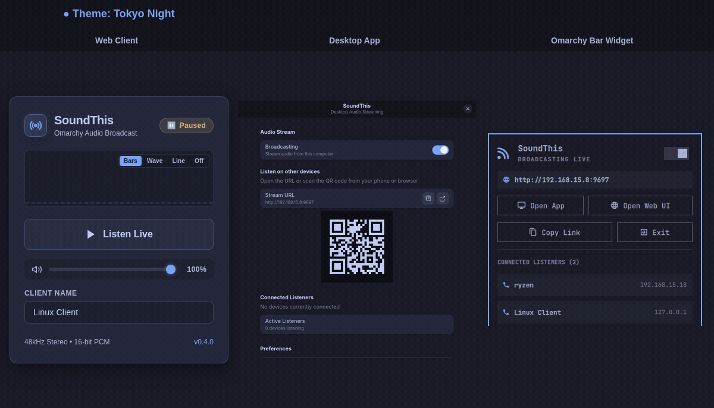
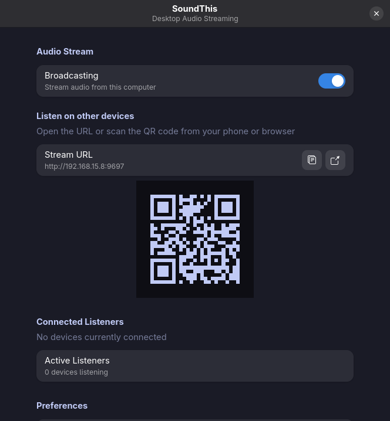
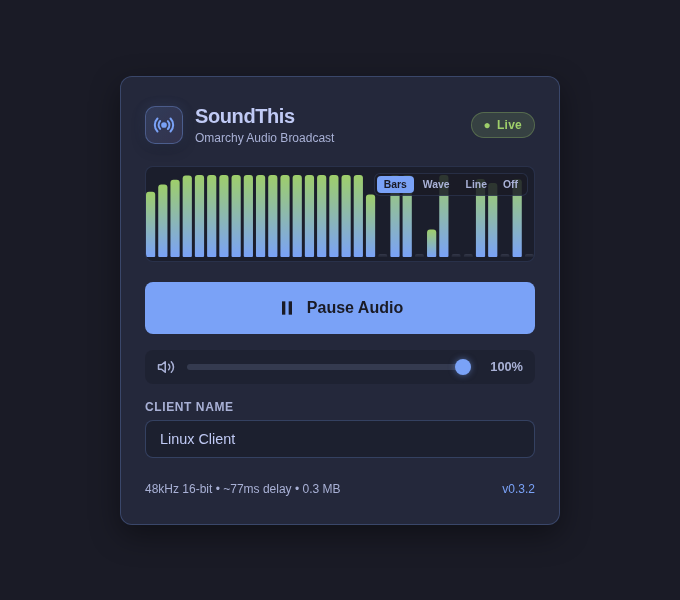
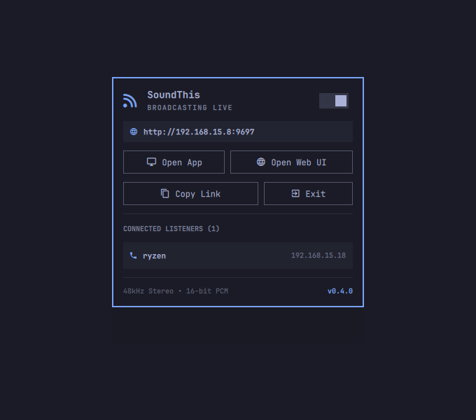
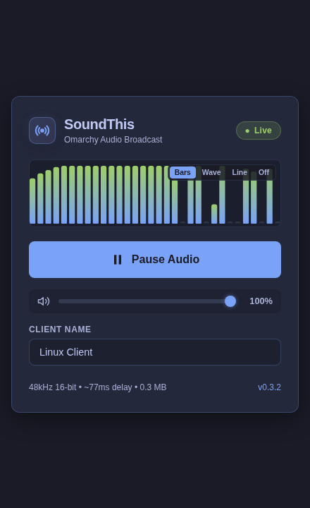

<p align="center">
  
</p>

<h1 align="center">SoundThis</h1>

<p align="center">
  <strong>Real-time desktop audio streaming for Omarchy Linux</strong><br>
  Ultra-low latency, single-binary, and built natively with Rust &amp; Vite.
</p>

<p align="center">
  <a href="https://github.com/rodvieirasilva/soundthis/releases"></a>
  <a href="https://github.com/rodvieirasilva/soundthis/actions/workflows/ci.yml"></a>
  <a href="LICENSE"></a>
  
</p>

SoundThis captures the audio playback from your Omarchy desktop (PipeWire/PulseAudio) in real-time and streams it to any web browser on your local network (smartphones, laptops, tablets, smart TVs) with ultra-low latency (~30–50ms) using WebSockets and the Web Audio API.

---

## Preview

<p align="center">
  
</p>

<p align="center">
  <em>Live synchronized theme switching across all 3 interfaces: Web Client, Native GTK4 Desktop App, and Omarchy Bar Widget (cycling Tokyo Night, Catppuccin Latte, Gruvbox, and White).</em>
</p>

<details>
<summary><strong>View Individual Static Screenshots</strong></summary>
<br>

<p align="center">
  
  &nbsp;
  
  &nbsp;
  
</p>

<p align="center">
  <em>Left: Native GTK4 / Libadwaita desktop application with live QR code, single-instance window focusing, and listener telemetry.<br>
  Center: Embedded web player with real-time waveform visualizer, client naming, and 0ms event-driven theme sync.<br>
  Right: Native Omarchy desktop bar widget and popout panel showing server link and active listeners.</em>
</p>

</details>

---

## Why SoundThis? (Comparison & Alternatives)

SoundThis was created as a modern, lightweight Linux alternative inspired by [SoundIt](https://soundit.app/). While SoundIt provides convenient audio streaming from Windows to mobile browsers, it is closed-source, proprietary, and limited to Windows hosts.

Other cross-platform tools like **AudioRelay** require installing dedicated native apps or APKs on every receiving phone/client, impose freemium restrictions, and consume significant memory (~80–120 MB RAM). Solutions like **Snapcast** or **RTP multicast** introduce high latency or require complex routing and custom daemon setups.

| Feature / Solution | **SoundThis** | [SoundIt](https://soundit.app/) | [AudioRelay](https://audiorelay.net/) | Snapcast / RTP Multicast |
|---|---|---|---|---|
| **Host OS** | **Omarchy / Arch Linux (Native)** | Windows only | Windows, Linux, macOS | Linux |
| **Supported Architectures** | **x86_64 & aarch64 (ARM64)** | x86_64 only | x86_64, ARM | x86_64, ARM |
| **Server RAM Footprint** | **~7 MB RAM (Sub-3ms startup)** | ~50–80 MB RAM | ~80–120 MB RAM (Java/Electron) | ~15–30 MB RAM |
| **Server CPU Usage** | **< 0.5% CPU (Active stream)** | ~2–5% CPU | ~3–7% CPU | ~1–3% CPU |
| **Client Requirement** | **Any Web Browser (Zero Install)** | Web Browser | Dedicated Mobile/Desktop App | Dedicated client daemon |
| **Client Web Heap** | **< 20 MB (Leak-free playback)** | ~30–50 MB | Dedicated App (~80 MB) | N/A (daemon) |
| **Desktop Integration** | **Native Omarchy App + Bar Widget** | Windows Tray | System Tray / GUI Window | None (CLI daemon) |
| **Binary Layout** | **Single unified binary** | Multi-file installer | Multi-file package | Multi-package |
| **Audio Latency** | **Ultra-low (~30–50ms)** | ~50–100ms | ~40–80ms | ~200–1000ms |
| **Theme Support** | **Dynamic Omarchy OS sync** | Static theme | Static theme | None |
| **Open Source** | **MIT License** | Proprietary | Proprietary (Freemium) | GPL |

### Why SoundThis is Simpler & Better:
- **Zero Client Installation**: Any phone (iOS/Android), tablet, laptop, or smart TV can connect immediately through its native browser. No apps, APKs, or store downloads required.
- **Ultra-Lightweight & Efficient**: Built in async Rust (Axum + Tokio) with a tiny memory footprint (~7 MB RSS) and near-zero CPU usage (< 0.5%).
- **Completely Self-Contained**: The web player and native GTK4/Adwaita desktop window are pre-compiled and embedded directly inside a single binary (~6.2 MB with GUI, ~2.8 MB headless) via `include_str!`. Zero external runtime assets or internet access required.
- **Native Omarchy Desktop Experience**: Right-click the bar widget to toggle sharing on/off, click to view connected listeners, or copy the LAN link with one tap.

---

## Highlights

- **Single Self-Contained Binary**: One unified executable (`/usr/bin/soundthis`) containing the async Rust audio streaming server, the embedded Vite web client, and the compiled native GTK4/Adwaita desktop application.
- **Compiled GTK4 & Libadwaita Desktop UI**: Built natively in Rust for Omarchy Linux with zero external interpreters or subprocesses (following the architecture of tools like `lan-mouse`). Features built-in single-instance window focusing, live QR code for mobile scanning, connected listener telemetry, and instant stream URL copy/open actions.
- **Event-Driven Theme Syncing**: Live theme palette support powered by Omarchy's native `omarchy-hook theme-set` event and pushed over WebSockets directly to connected web clients with 0ms latency. Zero HTTP polling.
- **On-Demand Lifecycle**: Starts streaming instantly when opened from the app launcher. When the window closes, it stops streaming cleanly, or optionally continues streaming in the background with the Omarchy bar widget if "Keep streaming in Omarchy bar" is checked.
- **Native Rust Server**: Axum + Tokio async WebSocket broadcast server with minimal memory footprint (~7 MB RSS) and sub-3ms startup.
- **Embedded Vite Web Client**: Single-file bundled frontend (`TypeScript` + `Vite` + `AudioContext`), compiled and embedded directly inside the binary via `include_str!`. Zero external runtime assets needed.
- **TOML Configuration Support**: Fully customizable via `~/.config/soundthis/config.toml` or custom path with `--config`.
- **HTTP & HTTPS with Auto-TLS**: Native TLS support via `rustls`, including auto-generating self-signed X.509 certificates for localhost and your LAN IP.
- **Omarchy Shell Integration**: Native bar widget (`KeyboardPanel` + `BarIconButton`) with live broadcast status, client count, and an interactive popout panel.
- **Ultra-Low Latency (~30–50ms)**: Streams 48kHz 16-bit stereo PCM with scheduled jitter buffers.
- **Comprehensive Test Suite & Quality**: Strict >= 80% test coverage enforced across both Rust (`cargo-llvm-cov`) and TypeScript (`Vitest`), with zero clippy/ESLint warnings.

---

## Installation

### Via Omarchy Package (Recommended for Omarchy Linux)

SoundThis provides an automated zero-touch installation. Simply install the package via the Omarchy launcher/store or terminal:

```bash
omarchy pkg add soundthis
```

> [!NOTE]
> Installing the package registers the **SoundThis** desktop application in your application launcher (`soundthis.desktop`) and deploys the Omarchy top bar widget (`plugin/Panel.qml`).
> 
> Simply launch **SoundThis** from your application menu or run `soundthis` to open the desktop app and start streaming on demand.
> 
> To remove completely:
> ```bash
> omarchy pkg drop soundthis
> ```

---

### From GitHub Releases (Fastest — Standalone Binary)

Pre-built standalone Linux binaries are published for both **x86_64** (AMD64/Intel) and **aarch64** (ARM64) with every release on [GitHub Releases](https://github.com/rodvieirasilva/soundthis/releases).

#### Option A: Quick Install (curl)
```bash
# Auto-detect architecture (x86_64 or aarch64), download latest release, and install
ARCH=$(uname -m)
curl -sL "https://github.com/rodvieirasilva/soundthis/releases/latest/download/soundthis-v0.6.0-${ARCH}-linux.tar.gz" | tar -xz -C ~/.local/bin soundthis
soundthis install
```

#### Option B: GitHub CLI (`gh`)
```bash
ARCH=$(uname -m)
gh release download --repo rodvieirasilva/soundthis --pattern "*${ARCH}*.tar.gz"
tar -xzf soundthis-*-${ARCH}-linux.tar.gz
install -m 755 soundthis ~/.local/bin/soundthis
soundthis install
```

#### Option C: Manual Download
1. Download `soundthis-*-<x86_64|aarch64>-linux.tar.gz` matching your system architecture from the [Releases page](https://github.com/rodvieirasilva/soundthis/releases).
2. Extract the archive: `tar -xzf soundthis-*.tar.gz`.
3. Copy the executable to your path: `install -m 755 soundthis ~/.local/bin/soundthis`.
4. Run `soundthis install` to configure the Omarchy desktop entry and top bar widget.

---

### Via Cargo

```bash
# Direct install from Git repository:
cargo install --git https://github.com/rodvieirasilva/soundthis.git

# Or install from local source:
git clone https://github.com/rodvieirasilva/soundthis.git
cd soundthis
cargo install --path .

# Configure systemd daemon and Omarchy bar widget:
soundthis install
```

---

### Via Mise (Development & Source Build)

```bash
# Clone the repository
git clone https://github.com/rodvieirasilva/soundthis.git
cd soundthis

# Build frontend bundle, compile binary, and install everything in one step:
mise run install
```

`soundthis install` automatically handles:
1. Installing the binary to your environment.
2. Generating the systemd user service unit (`soundthis.service`) and starting the background daemon.
3. Deploying the Omarchy shell plugin to `~/.config/omarchy/plugins/soundthis/`.
4. Registering the widget into the Omarchy bar layout (`~/.config/omarchy/shell.json`).

---

### Via Docker (Containerized Audio Streaming)

You can run SoundThis inside a Docker or Podman container that captures audio directly from your host machine's PipeWire or PulseAudio daemon:

#### Option A: Using the Runner Script (Recommended)
```bash
./scripts/docker-run.sh
```
Or via Mise:
```bash
mise run docker:run
```

#### Option B: Docker Compose
```bash
docker compose up -d
```

#### Option C: Docker Run CLI
```bash
docker run -d \
  --name soundthis \
  --network host \
  -e PULSE_SERVER=unix:/tmp/pulse/native \
  -v "${XDG_RUNTIME_DIR:-/run/user/$(id -u)}/pulse/native:/tmp/pulse/native:ro" \
  -v "${HOME}/.config/pulse/cookie:/root/.config/pulse/cookie:ro" \
  soundthis:latest
```

> [!TIP]
> The container connects to your host's audio server by mounting the PipeWire/PulseAudio UNIX domain socket into `/tmp/pulse/native`. With `--network host`, startup takes < 3ms with the same ultra-low latency streaming (~30–50ms).

---

## Configuration (`config.toml`)

SoundThis automatically creates a default configuration file at `~/.config/soundthis/config.toml` on first run if it does not already exist.

```toml
# SoundThis Configuration File
# Location: ~/.config/soundthis/config.toml

# Server port (default: 9697)
port = 9697

# Bind address (default: "0.0.0.0" accepts local and LAN connections)
host = "0.0.0.0"

# Protocol: "http" or "https" (default: "http")
protocol = "http"

[tls]
# Path to TLS certificate and private key in PEM format (used when protocol is "https")
# If left unset or set to auto_generate = true, a self-signed certificate is auto-generated
# cert_path = "~/.config/soundthis/certs/cert.pem"
# key_path = "~/.config/soundthis/certs/key.pem"
auto_generate = true

[cors]
# Allowed origins for HTTP and WebSocket requests (default: ["*"])
allow_origins = ["*"]
allow_methods = ["GET", "POST", "OPTIONS"]
allow_headers = ["*"]

[audio]
# Audio capture settings for PipeWire / PulseAudio
sample_rate = 48000
channels = 2
chunk_size = 3840
latency_ms = 20

[desktop]
# Continue audio streaming in background when the desktop application window closes (default: true)
# When set to false, closing the GTK4 window stops streaming completely.
keep_streaming = true
```

### Desktop Keep Streaming Behavior

The `keep_streaming` setting in `[desktop]` dictates the lifecycle of the streaming server when closing the GTK4 desktop application:
- **`true` (Default)**: Closing the desktop window keeps audio streaming active in the background, allowing seamless playback on connected devices and continued status tracking in the Omarchy top bar widget.
- **`false`**: Closing the desktop window terminates active streaming immediately.

You can toggle this preference at any time from:
1. The **"Keep streaming in Omarchy bar"** switch in the native desktop app preferences.
2. The REST API endpoint: `POST /api/v1/config/keep_streaming` with `{"keep": true|false}` (or `GET /api/v1/config/keep_streaming`). Legacy `/api/*` requests automatically redirect to `/api/v1/*`.
3. Directly editing `keep_streaming` in `~/.config/soundthis/config.toml`.

You can also specify a custom configuration file using the `--config` flag:
```bash
soundthis --config /path/to/my-config.toml serve
```

---

## Usage

### Web Client
Open the streaming page on any device connected to your network (smartphones, tablets, laptops, smart TVs):

```
http://<YOUR_LAN_IP>:9697
# Or https://<YOUR_LAN_IP>:9697 if HTTPS is enabled
```
*(Shown in `soundthis status` and in the Omarchy bar popout)*

<p align="center">
  
</p>


### Desktop App & Omarchy Integration
- **App Launcher / CLI**: Launch `soundthis` with no arguments in your Omarchy desktop session to open the native GTK4 / Libadwaita desktop application.
- **Dynamic Theming**: The desktop UI and web client dynamically match your active Omarchy theme colors live from `colors.toml`.
- **Omarchy Bar Widget**:
  - **Left Click**: Opens the SoundThis control panel showing LAN link, connected listeners, and controls.
  - **Right / Middle Click**: Immediately toggles audio sharing between Enabled and Disabled.

### CLI Commands
```bash
soundthis             # Open desktop application (or starts server in headless)
soundthis app         # Explicitly launch desktop application
soundthis status      # View streaming status and connected clients
soundthis toggle      # Toggle audio sharing on/off
soundthis enable      # Enable audio sharing
soundthis disable     # Disable audio sharing
soundthis open        # Open client page in default browser
soundthis serve       # Run streaming server in foreground
soundthis serve --https # Run server with HTTPS enabled
soundthis stop        # Stop active streaming session
soundthis install     # Configure Omarchy desktop entry and bar widget
soundthis uninstall   # Completely remove plugin and service
```

### OpenAPI & Interactive Swagger UI

SoundThis includes built-in interactive OpenAPI 3.1 documentation and Swagger UI served directly by the Rust binary:

- **Interactive Swagger UI**: `http://<LAN_IP>:9697/swagger-ui/` (or `http://localhost:9697/swagger`)
- **OpenAPI JSON Specifications**: `http://<LAN_IP>:9697/api-docs/openapi.json` and `http://<LAN_IP>:9697/openapi.json`

Inspect endpoints, test streaming toggles, inspect theme color palettes, and query live connected listeners right from your browser.

### Containerized Execution (Docker / Podman)

SoundThis can run inside an Arch Linux runtime container, fully configured for security with a non-root unprivileged user (`soundthis`, UID 1000):

```bash
# Using the automated container launcher (shares host PipeWire/PulseAudio socket):
./scripts/docker-run.sh

# Or running directly:
docker run --rm -it --network host \
  -e PULSE_SERVER=unix:/tmp/pulse/native \
  -v "${XDG_RUNTIME_DIR}/pulse/native:/tmp/pulse/native:ro" \
  soundthis:latest serve
```

---

## Development, Testing & Quality

SoundThis uses `mise.toml` as the unified task runner for development, linting, testing, and coverage reports.

### Testing & Coverage (>= 80% Threshold)

```bash
mise run test            # Run all web and server unit/integration tests
mise run test:web        # Run frontend Vitest tests
mise run test:server     # Run Rust tests
mise run coverage        # Generate full coverage report for both Rust and Web
mise run coverage:rust   # Generate cargo-llvm-cov report (current: ~81.4% line coverage)
mise run coverage:web    # Generate Vitest v8 coverage report (current: ~90.9% line coverage)
```

### Linters & Formatting

```bash
mise run lint            # Run all linters (cargo clippy with -D warnings, rustfmt, ESLint)
mise run lint:rust       # Run cargo clippy & cargo fmt --check
mise run lint:web        # Run ESLint on frontend TypeScript
mise run fmt             # Automatically format Rust code
```

### Versioning & Release Process

For the step-by-step guide to bumping versions, creating multi-architecture GitHub releases, and submitting packaging updates to Omarchy Linux (`omacom/omarchy-pkgs`), see:

👉 **[Release & Versioning Guide](docs/release-process.md)**

---

## Architecture (SOLID Principles)

- **`src/config.rs`**: Single responsibility for configuration parsing (TOML), TLS certificate resolution/generation, and CORS rules.
- **`src/audio/`**:
  - `source.rs`: `AudioSource` trait defining pluggable audio capture backends (`ParecAudioSource` for PipeWire/PulseAudio, `MockAudioSource` for testing).
  - `broadcaster.rs`: `AudioBroadcaster` fan-out channel with low-latency frame dropping for lagged clients.
- **`src/state.rs`**: Thread-safe `AppState` managing active connections and streaming toggles.
- **`src/server/`**:
  - `mod.rs`: Server bootstrapping and CORS configuration with support for both HTTP (`axum`) and HTTPS (`axum-server` with `tls-rustls`).
  - `http.rs`: HTTP endpoints and embedded asset delivery.
  - `openapi.rs`: OpenAPI 3.1 schema specification and Swagger UI routing.
  - `ws.rs`: WebSocket streaming session handling and client identification.
- **`src/installer/`**: External templates (`systemd/soundthis.service.template`, `plugin/`) and systemd/Omarchy shell management.
- **`src/ui/`**: Native compiled GTK4 & libadwaita desktop window (`gtk_app.rs`) with built-in GApplication single-instance handling and preferences.
- **`web/`**: Single-responsibility TypeScript modules:
  - `audio/player.ts`: `AudioStreamPlayer` managing AudioContext and scheduled audio buffer playback.
  - `audio/visualizer.ts`: `CanvasVisualizer` rendering responsive frequency spectrum bars.
  - `services/storage.ts`: Persistent device settings with validation.
  - `services/ws.ts`: Resilient WebSocket connection manager with auto-reconnect.
  - `ui/app.ts`: Application orchestrator and UI event coordinator.

For comprehensive architectural patterns, quality gates, and AI contributor rules, see [AGENTS.md](AGENTS.md) and the [Release Process Guide](docs/release-process.md).

---

## License

[MIT License](LICENSE) &copy; 2026 Rodrigo Vieira

